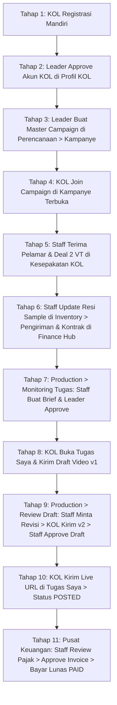

# DOKUMEN TEST CASE & PENGUJIAN END-TO-END (QA / UAT)
## SISTEM MANAJEMEN KOL & PELACAKAN KAMPANYE

**Dokumen Panduan Pengujian QA (Quality Assurance) Komprehensif**  
**Basis URL Sistem:** `http://localhost:8000`  
**Cakupan Siklus:** Registrasi KOL ➔ Master Campaign ➔ Join Campaign (Apply) ➔ Dealing ➔ Production (Brief & Draft Revisi) ➔ Live Posting ➔ Finance Hub (Invoice & Lunas `PAID`)  
**Versi Dokumen:** 4.0 (Full Sidebar Navigation & Finance Hub Alignment)  
**File Target:** `KOL-System/docs/TEST_CASE_KOL_SYSTEM.md`  

---

## 1. PETA PERAN PENGGUNA & KREDENSIAL LOGIN (3 TEST ACTORS)

Untuk menjalankan skenario pengujian penuh dari awal sampai akhir, QA Tester dapat login di `http://localhost:8000/administrator/login` menggunakan **Email** maupun **Username** dengan kredensial aktif berikut:

| Role / Aktor | Nama Akun | Email Login | Username Login | Password | Grup ID | Akses & Wewenang di Sidebar |
| :--- | :--- | :--- | :--- | :--- | :--- | :--- |
| **LEADER KOL** | Master KOL | `master@gmail.com` | `masterkol` | `password` | `Leader KOL` (6) | • Membuat Master Campaign di menu **Perencanaan ➔ Kampanye**.<br>• Approve profil KOL baru.<br>• Menyetujui Brief Konten di menu **Production ➔ Monitoring Tugas & Brief**.<br>• Memantau ROI & Leaderboard di **Evaluasi ➔ Peringkat KOL**. |
| **STAFF KOL** | Budi Pratama | `operational@gmail.com` | `operational_budi` | `password` | `Operational` (5) | • Terima pelamar di **Perencanaan ➔ Kampanye** & atur deal 2 VT di **Kesepakatan KOL**.<br>• Buat brief di **Production ➔ Monitoring Tugas & Brief**.<br>• **Approve & Minta Revisi Draft di Production ➔ Review Draft**.<br>• Kelola logistik di **Inventory ➔ Pengiriman**.<br>• Review pajak & bayar invoice di **Pusat Keuangan** (`/administrator/finance_hub`). |
| **TALENT KOL (Siap Pakai)** | Miawaug | `miawaug@gmail.com` | `kol_miawaug` | `password123` | `Kol` (7) | Akun Talent siap pakai jika ingin langsung menguji tanpa registrasi baru. |
| **TALENT KOL (Alur Regis)** | Bintang (Baru) | `bintang.kol@example.com` | `kol_bintang` | `bintang123` | `Kol` (7 pasca approve) | Akun hasil pengujian registrasi mandiri di `/web/register` ➔ Mengakses **Tugas Saya** (`/administrator/my_tasks`) & **Kampanye Terbuka**. |
| **SUPERADMIN (Opsional)** | Developer | `developer@gmail.com` | `devmetafora` | `developer` | `Admin` (1) | Akses konfigurasi sistem global & manajemen master data. |

---

## 2. STRUKTUR MENU SIDEBAR (ACUAN NAVIGASI QA)

Seluruh pengujian dilakukan dengan mengklik menu yang ada di **Sidebar**, tanpa perlu mengetik URL manual:

* 📊 **Dashboard** (`/administrator/dashboard`)
* 📅 **Perencanaan (Planning)**:
  * ↳ **Profil KOL** (`/administrator/kols`)
  * ↳ **Kampanye** (`/administrator/campaigns`)
  * ↳ **Kesepakatan KOL** (`/administrator/campaign_kols`)
* ⚙️ **Production**:
  * ↳ **Monitoring Tugas & Brief** (`/administrator/tasks?view=monitoring`)
  * ↳ **Review Draft** (`/administrator/tasks?view=review_draft`)
  * ↳ **Live Posting** (`/administrator/tasks?view=live_posting`)
  * ↳ **Schedule Calendar** (`/administrator/kalender`)
* 📦 **Inventory**:
  * ↳ **Produk** (`/administrator/products`)
  * ↳ **Pengiriman** (`/administrator/kol_shipments`)
  * ↳ **Riwayat Stok** (`/administrator/stock_history`)
* 💰 **Keuangan (Finance)**:
  * ↳ **Pusat Keuangan** (`http://localhost:8000/administrator/finance_hub`)
* 📈 **Evaluasi (Evaluation)**:
  * ↳ **Peringkat KOL** (`/administrator/dashboard/chart`)
  * ↳ **Evaluasi Internal** (`/administrator/internal_evaluation`)
* 🎯 **Portal Kreator KOL**:
  * ↳ **Tugas Saya** (`http://localhost:8000/administrator/my_tasks`)
  * ↳ **Kampanye Terbuka** (`http://localhost:8000/administrator/open_campaigns`)

---

## 3. PANDUAN PENGUJIAN END-TO-END BERURUTAN (10 TAHAP)



---

### TAHAP 1: REGISTRASI MANDIRI TALENT KOL (PADA CARD GENERATOR PLUGIN)
* **Aplikasi:** `KOL-System-card-generator-plugin` (KOL Hub & Creator Portal)
* **Aktor:** Talent KOL
* **Navigasi:** Akses form pendaftaran publik di Card Generator Plugin: `/web/register`
* **Pre-Kondisi:** Browser dalam kondisi belum login (*Guest/Incognito*).

> 💡 **Shortcut QA:** Jika QA ingin langsung menguji alur operasional kampanye di `KOL-System` (`http://localhost:8000`), QA dapat **melewati Tahap 1 & 2** dan langsung login menggunakan akun KOL siap pakai: **`kol_miawaug`** (Password: `password123`).

| No | Langkah Pengujian | Data Uji | Hasil yang Diharapkan (Expected Result) |
| :- | :--- | :--- | :--- |
| 1.1 | Buka form `/web/register` pada aplikasi Card Generator Plugin. | - | Form pendaftaran KOL terbuka. |
| 1.2 | Isi Nama Lengkap, Username, Email, Password, dan Platform Akun Media Sosial. | • **Nama:** `Bintang Influencer`<br>• **Username:** `kol_bintang`<br>• **Email:** `bintang.kol@example.com`<br>• **Password:** `bintang123`<br>• **Platform:** TikTok (`@bintang_review`) | Form terisi lengkap tanpa error validasi. |
| 1.3 | Klik tombol **Daftar / Register**. | - | Muncul alert sukses: *"Registration successful. Your account is pending admin approval."* Data profil tersimpan dengan status `PENDING`, dan akun login user tersimpan di `aauth_users` dengan status **Banned** sementara. |
| 1.4 | Coba login di `http://localhost:8000/administrator/login` dengan akun tersebut sebelum di-approve. | Username: `kol_bintang`, Password: `bintang123` | **Login ditolak oleh sistem** karena akun masih berstatus banned menunggu approval Leader di Card Generator. |

---

### TAHAP 2: LEADER APPROVE AKUN KOL (PADA CARD GENERATOR PLUGIN)
* **Aplikasi:** `KOL-System-card-generator-plugin` (Approval & Role Provisioning)
* **Aktor:** Leader KOL
* **Navigasi:** Login sebagai `masterkol` di Card Generator Plugin ➔ Buka menu **Profil KOL / KOLs** (`/administrator/kols`)
* **Pre-Kondisi:** Leader telah login di Card Generator Plugin.

| No | Langkah Pengujian | Data Uji | Hasil yang Diharapkan (Expected Result) |
| :- | :--- | :--- | :--- |
| 2.1 | Buka menu **Profil KOL** pada Card Generator Plugin. | - | Profil `Bintang Influencer` muncul di tabel dengan badge status **`PENDING`**. |
| 2.2 | Klik tombol centang hijau (**Approve**). | - | Muncul pesan sukses: *"KOL approved and user account activated successfully."* |
| 2.3 | Validasi Akun KOL (Database Bersama). | Akun `kol_bintang` | Logika approval di Card Generator otomatis meng-**UNBAN** user dan otomatis memasukkannya ke grup **`Kol`** (Group ID: 7). |
| 2.4 | Buka aplikasi utama `http://localhost:8000/administrator/login`, login dengan akun KOL yang baru disetujui. | `bintang.kol@example.com` / `bintang123` | **KOL berhasil login ke `http://localhost:8000`** dan siap mengakses portal kreator (*Tugas Saya* & *Kampanye Terbuka*). |

---

### TAHAP 3: LEADER MEMBUAT MASTER CAMPAIGN
* **Aktor:** Leader KOL
* **Navigasi Sidebar:** Klik menu **Perencanaan ➔ Kampanye** (`/administrator/campaigns`) ➔ Klik tombol **Tambah Kampanye**
* **Pre-Kondisi:** Login sebagai `masterkol`.

| No | Langkah Pengujian | Data Uji | Hasil yang Diharapkan (Expected Result) |
| :- | :--- | :--- | :--- |
| 3.1 | Masuk menu **Perencanaan ➔ Kampanye** ➔ Klik **Tambah Kampanye**. | - | Form pembuatan kampanye terbuka. |
| 3.2 | Isi Nama Kampanye, Brand, Total Budget, Kuota Slot, Periode Tanggal, dan Varian Produk. | • **Nama:** `Campaign Q4 Parfum Viral`<br>• **Brand:** `Metafora Perfume`<br>• **Total Budget:** `50.000.000`<br>• **Max Slots:** `5`<br>• **Start Date:** Hari ini, **End Date:** +30 hari<br>• **Varian:** Black Opium & Sweet Vanilla | Form tervalidasi lengkap. |
| 3.3 | Klik tombol **Simpan**. | - | Kampanye berhasil dibuat dengan status **`ACTIVE`** dan muncul di daftar kampanye. |

---

### TAHAP 4: KOL JOIN / LAMAR CAMPAIGN TERBUKA
* **Aktor:** Talent KOL
* **Navigasi Sidebar / URL:** Buka menu **Kampanye Terbuka** (`http://localhost:8000/administrator/open_campaigns`)
* **Pre-Kondisi:** Login sebagai `kol_bintang`.

| No | Langkah Pengujian | Data Uji | Hasil yang Diharapkan (Expected Result) |
| :- | :--- | :--- | :--- |
| 4.1 | Buka menu **Kampanye Terbuka**. | - | Menampilkan kartu kampanye aktif `Campaign Q4 Parfum Viral`. |
| 4.2 | Klik kartu kampanye untuk membaca detail kriteria & brief. | - | Detail kampanye terbuka. |
| 4.3 | Klik tombol **Lamar Kampanye / Join Campaign**. | - | Modal formulir pendaftaran terbuka. |
| 4.4 | Masukkan Penawaran Harga (*Proposed Rate*) dan Pesan (*Pitch Message*). | • **Proposed Rate:** `5.000.000`<br>• **Pesan:** *"Saya siap membuat 2 video TikTok estetik review parfum."* | Format angka dan teks valid. |
| 4.5 | Klik tombol **Kirim Lamaran**. | - | Muncul notifikasi sukses: *"Pendaftaran Anda berhasil diajukan!"*. Status lamaran menjadi **`PENDING`**. |

---

### TAHAP 5: STAFF TERIMA PELAMAR & ATUR DEAL 2 VT (AUTO-GENERATE TASKS)
* **Aktor:** Staff KOL
* **Navigasi Sidebar:** Login sebagai `operational_budi` (`password`) ➔ Klik menu **Perencanaan ➔ Kampanye** lalu menu **Perencanaan ➔ Kesepakatan KOL**
* **Pre-Kondisi:** Login sebagai `operational_budi`.

| No | Langkah Pengujian | Data Uji | Hasil yang Diharapkan (Expected Result) |
| :- | :--- | :--- | :--- |
| 5.1 | Masuk menu **Perencanaan ➔ Kampanye** ➔ Buka list pelamar (`campaigns/applications/{campaign_id}`). | `Campaign Q4 Parfum Viral` | Pelamar `Bintang Influencer` tercantum berstatus `PENDING`. |
| 5.2 | Klik tombol centang hijau (**Accept Applicant**). | - | Lamaran disetujui (`ACCEPTED`) dan data otomatis masuk ke tabel deal dengan status awal `NEGOTIATION`. |
| 5.3 | Buka menu sidebar **Perencanaan ➔ Kesepakatan KOL** (`/administrator/campaign_kols`). | - | Baris deal KOL Bintang muncul di daftar kesepakatan. |
| 5.4 | Klik tombol Edit / Detail pada deal KOL Bintang. | - | Form pengaturan kesepakatan terbuka. |
| 5.5 | Masukkan Deal Amount: `5.000.000`, set **Jumlah VT = 2**, pilih varian parfum, dan simpan. | Deal: `5.000.000`, **Jumlah VT: 2** | Deal tersimpan, dan sistem **SECARA OTOMATIS MEN-GENERATE 2 BARIS TUGAS DI MODUL PRODUCTION (VT 1 & VT 2)** dengan status awal **`DRAFT`**. |

---

### TAHAP 6: LOGISTIK SAMPLE & KONTRAK AKTIF (PRASYARAT PRODUCTION)
* **Aktor:** Staff KOL
* **Navigasi Sidebar:** 
  1. Menu **Inventory ➔ Pengiriman** (`/administrator/kol_shipments`)
  2. Menu **Keuangan ➔ Pusat Keuangan** (`http://localhost:8000/administrator/finance_hub`)
* **Pre-Kondisi:** Login sebagai `operational_budi`.

| No | Langkah Pengujian | Data Uji | Hasil yang Diharapkan (Expected Result) |
| :- | :--- | :--- | :--- |
| 6.1 | Buka menu sidebar **Inventory ➔ Pengiriman** (`/administrator/kol_shipments`). | - | Tabel logistik pengiriman sampel parfum terbuka. |
| 6.2 | Tambah / Update data pengiriman sampel untuk KOL Bintang. | Kurir: `J&T`, Resi: `JT00123456`, Status: **`DELIVERED`** | Status sampel menjadi **`Delivered`** (memenuhi syarat upload draft video). |
| 6.3 | Buka menu sidebar **Keuangan ➔ Pusat Keuangan** (`http://localhost:8000/administrator/finance_hub`). | - | Dashboard terpadu keuangan terbuka menampilkan baris transaksi KOL Bintang. |
| 6.4 | Pastikan kontrak kerja sama untuk deal tersebut berstatus **`ACTIVE`** (atau `SIGNED`). | No Kontrak: `KTR/2026/001`, Status: **`ACTIVE`** | Kontrak berstatus Active. *(Proteksi blocker `_check_contract_active` terbuka, siap masuk tahap Production)*. |

---

### TAHAP 7: PRODUCTION ➔ MONITORING TUGAS & BRIEF (STAFF BUAT & LEADER APPROVE)
* **Aktor:** Staff KOL & Leader KOL
* **Navigasi Sidebar:** Klik menu **Production ➔ Monitoring Tugas & Brief** (`/administrator/tasks?view=monitoring`)
* **Pre-Kondisi:** Staff `operational_budi` dan Leader `masterkol`.

| No | Langkah Pengujian | Data Uji | Hasil yang Diharapkan (Expected Result) |
| :- | :--- | :--- | :--- |
| 7.1 | *(Staff)* Buka menu sidebar **Production ➔ Monitoring Tugas & Brief**. | - | Daftar tugas VT 1 dan VT 2 muncul berstatus `DRAFT`. |
| 7.2 | *(Staff)* Pada task VT 1, klik icon kalender (**Lengkapi Jadwal & SOW**). | • Estimasi Tayang: +7 hari<br>• Catatan Brief: *"Unboxing parfum, sebutkan aroma vanilla & ketahanan 12 jam"* | Teks brief tersimpan dan status task berubah menjadi **`PENDING_REVIEW`**. |
| 7.3 | *(Leader)* Login sebagai `masterkol` ➔ Masuk menu **Production ➔ Monitoring Tugas & Brief**. | Task VT 1 | Leader melihat task VT 1 yang memerlukan approval brief. |
| 7.4 | *(Leader)* Klik tombol centang hijau (**Approve Brief**). | - | Brief disetujui, dan **status task otomatis berubah maju ke `WAITING_DRAFT`** (siap diproduksi oleh KOL). |

---

### TAHAP 8: KOL SUBMIT DRAFT VIDEO PERTAMA (DRAFT v1)
* **Aktor:** Talent KOL
* **Navigasi Sidebar / URL:** Buka menu **Tugas Saya** (`http://localhost:8000/administrator/my_tasks`)
* **Pre-Kondisi:** Login sebagai `kol_bintang`.

| No | Langkah Pengujian | Data Uji | Hasil yang Diharapkan (Expected Result) |
| :- | :--- | :--- | :--- |
| 8.1 | Buka menu **Tugas Saya** ➔ Tab *Perlu Draft*. | Task VT 1 | Task VT 1 muncul dengan badge abu-abu: `Needs Draft Upload`. Instruksi brief terbaca. |
| 8.2 | Klik tombol biru **Upload Draft Video**. | - | Modal pop-up form draft terbuka. |
| 8.3 | Masukkan Link Google Drive Video preview, Draft Caption, dan Hashtag. | • **Draft URL:** `https://drive.google.com/file/d/video_v1/view`<br>• **Caption:** *"Parfum terenak musim ini! Wangi mewah seharian #parfumviral"* | Input link URL dan teks valid. |
| 8.4 | Klik tombol **Kirimkan Draft**. | - | Muncul alert: *"Draft versi 1 berhasil dikirimkan!"*. **Status task otomatis berubah menjadi `IN_REVIEW_DRAFT`**. |

---

### TAHAP 9: PRODUCTION ➔ REVIEW DRAFT (STAFF MINTA REVISI, KOL RESUBMIT, STAFF APPROVE DRAFT)
* **Aktor:** Staff KOL & Talent KOL
* **Navigasi Sidebar:** 
  * Staff: Menu **Production ➔ Review Draft** (`/administrator/tasks?view=review_draft`)
  * KOL: Menu **Tugas Saya** (`http://localhost:8000/administrator/my_tasks`)
* **Pre-Kondisi:** Staff `operational_budi` dan KOL `kol_bintang`.

| No | Langkah Pengujian | Data Uji | Hasil yang Diharapkan (Expected Result) |
| :- | :--- | :--- | :--- |
| 9.1 | *(Staff)* Buka menu sidebar **Production ➔ Review Draft**. | Task VT 1 | Task berstatus `IN_REVIEW_DRAFT` tampil di daftar review draft. |
| 9.2 | *(Staff)* Klik icon link eksternal untuk meninjau preview video di Google Drive. | Link video v1 | Video dapat ditinjau kesesuaian kontennya. |
| 9.3 | *(Staff)* Klik tombol silang kuning (**Minta Revisi Draft** / <i class="fa fa-times"></i>). | Catatan: *"Musik latar terlalu keras, tolong kecilkan 20% dan perjelas visual botol parfum."* | Status task otomatis berubah menjadi **`REVISION_DRAFT`**. Catatan revisi tersimpan. |
| 9.4 | *(KOL)* Buka menu **Tugas Saya** (`/administrator/my_tasks`). | Task VT 1 | • Badge berubah menjadi kuning: **`Revision Requested`**.<br>• Muncul kotak catatan revisi Staff: *"Musik latar terlalu keras..."*.<br>• Tombol aksi berubah menjadi: **`Upload Revised Draft (v2)`**. |
| 9.5 | *(KOL)* Klik tombol **Upload Revised Draft (v2)**. | • **Draft URL v2:** `https://drive.google.com/file/d/video_v2_revisi/view`<br>• Catatan: *"Volume audio sudah diperbaiki"* | Modal terbuka, versi draft otomatis naik ke **Version 2**. |
| 9.6 | *(KOL)* Klik tombol Kirimkan Draft. | - | Draft v2 terkirim. **Status task kembali menjadi `IN_REVIEW_DRAFT`**. |
| 9.7 | *(Staff)* Buka kembali menu sidebar **Production ➔ Review Draft**. | Task VT 1 (v2) | Task muncul kembali siap disetujui. |
| 9.8 | *(Staff)* Klik tombol centang hijau (**Setujui Draft** / <i class="fa fa-check"></i>). | - | **Status task otomatis berubah menjadi `APPROVED_DRAFT`**. KOL mendapatkan izin untuk memposting ke publik. |

---

### TAHAP 10: PRODUCTION ➔ LIVE POSTING & SCRAPING PERFORMA
* **Aktor:** Talent KOL & Sistem
* **Navigasi Sidebar:** 
  * KOL: Menu **Tugas Saya** ➔ Tab *Siap Posting* (`http://localhost:8000/administrator/my_tasks`)
  * Staff: Menu **Production ➔ Live Posting** (`/administrator/tasks?view=live_posting`)
* **Pre-Kondisi:** Login sebagai `kol_bintang`.

| No | Langkah Pengujian | Data Uji | Hasil yang Diharapkan (Expected Result) |
| :- | :--- | :--- | :--- |
| 10.1 | Buka menu **Tugas Saya** ➔ Tab *Siap Posting*. | Task VT 1 | Status task: `Approved • Ready to Post`. Tombol konfirmasi live aktif. |
| 10.2 | Klik tombol hijau **Konfirmasi Tayang / Input Live URL**. | - | Modal input link video tayang terbuka. |
| 10.3 | Masukkan link video TikTok asli yang sudah diposting. | URL: `https://www.tiktok.com/@bintang_review/video/73918273645` | URL medsos valid. |
| 10.4 | Klik tombol **Konfirmasi Tayang**. | - | • **Status task resmi berubah menjadi `POSTED`**.<br>• Di menu sidebar **Production ➔ Live Posting** milik Staff, video terdaftar aktif.<br>• Record masuk antrean `apify_jobs` untuk scraping metrik (Views, Likes, ER, CPV). |

---

### TAHAP 11: PUSAT KEUANGAN ➔ APPROVE INVOICE & PELUNASAN PEMBAYARAN (PAID)
* **Aktor:** Staff KOL (Keuangan)
* **Navigasi Sidebar:** Klik menu **Keuangan ➔ Pusat Keuangan** (`http://localhost:8000/administrator/finance_hub`)
* **Pre-Kondisi:** Login sebagai `operational_budi`.

| No | Langkah Pengujian | Data Uji | Hasil yang Diharapkan (Expected Result) |
| :- | :--- | :--- | :--- |
| 11.1 | Buka menu sidebar **Keuangan ➔ Pusat Keuangan** (`/administrator/finance_hub`). | - | Menampilkan dashboard terpadu keuangan dengan 4 kartu statistik dan tabel transaksi. |
| 11.2 | Cari transaksi KOL Bintang pada tabel transaksi. | `Bintang Influencer` | Tampil kolom Deal (Rp 5.000.000), Status Kontrak (ACTIVE), dan Status Invoice. |
| 11.3 | Jika invoice berstatus `SUBMITTED` (Tab **Tagihan Masuk**), klik tombol **Review Tagihan / Pajak**. | Subtotal: `5.000.000`, PPh21: `2.5%` (Net: `4.875.000`) | Modal review rincian pajak & rekening bank KOL terbuka. |
| 11.4 | Klik tombol centang hijau (**Setujui Tagihan / Approve Invoice**). | - | Status invoice berubah menjadi **`APPROVED`** (atau `SIAP BAYAR`). Transaksi otomatis berpindah ke tab **Siap Dibayar**. |
| 11.5 | Pada tab **Siap Dibayar**, klik tombol hijau **Catat Pembayaran (Pay)** (<i class="fa fa-money"></i>). | - | Modal input pembayaran terbuka menampilkan sisa tagihan yang harus dibayar. |
| 11.6 | Masukkan Nominal Pembayaran Penuh, Tanggal Pembayaran, dan Metode Transfer Bank. | • **Nominal:** `4.875.000` (atau sesuai net payable)<br>• **Tanggal:** Hari ini<br>• **Metode:** `Bank Transfer (BCA)`<br>• **Catatan:** `Pelunasan honorarium campaign parfum 2 VT` | Form pembayaran tervalidasi. |
| 11.7 | Klik tombol **Simpan Pembayaran**. | - | • Record tersimpan di tabel `payments`.<br>• **STATUS INVOICE RESMI BERUBAH MENJADI `PAID` (LUNAS)**.<br>• Progress bar pembayaran menjadi 100% (Hijau).<br>• Transaksi berpindah ke tab **Lunas & Bukti Potong**. |
| 11.8 | *(Leader)* Buka menu sidebar **Evaluasi ➔ Peringkat KOL** dan **Evaluasi Internal**. | - | Sisa anggaran kampanye terupdate akurat, realisasi kas keluar tercatat di kartu statistik Finance Hub, dan performa efisiensi deal tercatat di leaderboard. |

---

## 4. CHECKLIST EKSEKUSI PENGUJIAN QA (PASS/FAIL CRITERIA)

QA Tester dapat mencetak atau menyalin lembar checklist ini saat melakukan pengujian:

```markdown
[ ] TAHAP 1:  Registrasi KOL di http://localhost:8000/web/register (bintang.kol@example.com / bintang123) ➔ Status PENDING.
[ ] TAHAP 2:  [LEADER] Login masterkol ➔ Sidebar Perencanaan > Profil KOL ➔ Klik Approve (Akun unbanned & group 'Kol').
[ ] TAHAP 3:  [LEADER] Sidebar Perencanaan > Kampanye ➔ Buat Campaign Baru (Budget 50jt, Status ACTIVE).
[ ] TAHAP 4:  [KOL] Login kol_bintang ➔ Buka Kampanye Terbuka (/open_campaigns) ➔ Submit lamaran (Proposed Rate 5jt).
[ ] TAHAP 5:  [STAFF] Login operational_budi ➔ Sidebar Perencanaan > Kampanye ➔ Accept Applicant.
[ ] TAHAP 6:  [STAFF] Sidebar Perencanaan > Kesepakatan KOL ➔ Atur deal 2 VT ➔ Auto-generate VT 1 & VT 2 terbukti ada di Production.
[ ] TAHAP 7:  [STAFF] Sidebar Inventory > Pengiriman ➔ Set resi DELIVERED & Pusat Keuangan (/finance_hub) pastikan kontrak ACTIVE.
[ ] TAHAP 8:  [STAFF] Sidebar Production > Monitoring Tugas & Brief ➔ Input brief SOW untuk VT 1.
[ ] TAHAP 9:  [LEADER] Login masterkol ➔ Sidebar Production > Monitoring Tugas ➔ Klik Approve Brief (Status task: WAITING_DRAFT).
[ ] TAHAP 10: [KOL] Login kol_bintang ➔ Buka Tugas Saya (/my_tasks) ➔ Upload draft video v1 (Status: IN_REVIEW_DRAFT).
[ ] TAHAP 11: [STAFF] Login operational_budi ➔ Sidebar Production > Review Draft ➔ Klik MINTA REVISI + isi catatan.
[ ] TAHAP 12: [KOL] Buka Tugas Saya (/my_tasks) ➔ Muncul badge Revision Requested & catatan terbaca ➔ Klik Upload Revised Draft (v2).
[ ] TAHAP 13: [KOL] Submit video revisi v2 ➔ Status kembali ke IN_REVIEW_DRAFT.
[ ] TAHAP 14: [STAFF] Sidebar Production > Review Draft ➔ Klik SETUJUI DRAFT (Status: APPROVED_DRAFT).
[ ] TAHAP 15: [KOL] Buka Tugas Saya ➔ Klik Konfirmasi Tayang ➔ Input link live TikTok (Status: POSTED).
[ ] TAHAP 16: [STAFF] Sidebar Keuangan > Pusat Keuangan (http://localhost:8000/administrator/finance_hub) ➔ Review pajak & Approve Invoice.
[ ] TAHAP 17: [STAFF] Di Pusat Keuangan klik Catat Pembayaran (Pay) lunas ➔ Status Invoice resmi berubah menjadi PAID (LUNAS).
```

---

*Dokumen ini merupakan panduan resmi pengujian sistem terintegrasi KOL Management System.*
