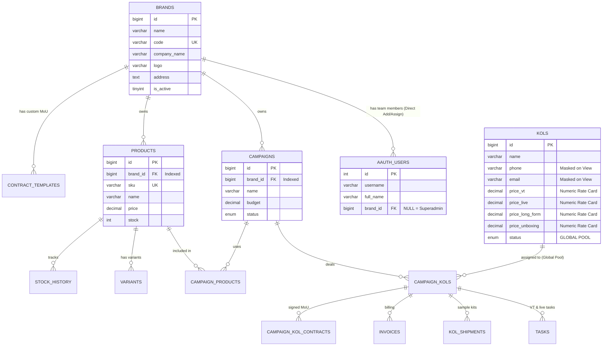

# Spesifikasi & Rencana Implementasi: Arsitektur Multi Brand (Satu Sistem, Banyak Brand)

Dokumen ini adalah spesifikasi arsitektur teknis dan panduan implementasi untuk mentransformasi sistem **KOLAB.ID (KOL-System-Apps)** dari model *single-brand* (yang saat ini berpusat pada satu brand "Metafora") menjadi arsitektur **Multi Brand terisolasi (Single Database Scoped Tenancy)** di CodeIgniter 3.

---

## 1. Ringkasan Eksekutif & Kebutuhan Bisnis

| Aspek | Deskripsi Kebijakan |
|---|---|
| **Model Tenancy** | *Single Database with Tenant Scoping* (`brand_id`) + B-Tree Indexes |
| **Isolasi Tim** | **Ketat**. Tim Brand 1 (Leader & Staff) tidak dapat melihat info, campaign, produk, tugas, resi, kontrak, maupun tagihan Brand 2 |
| **KOL Talent Pool** | **Global / Shared Pool**. Master data KOL tetap 1 pool bersama, namun penugasan, deals, kontrak, dan tagihan terisolasi per brand |
| **Pendaftaran KOL** | **Otomatis Global**. Setiap penambahan KOL dari brand manapun langsung masuk ke talent pool global |
| **Pembersihan Rate Card File** | Field upload file rate card **dihapus total**. Rate card diisi sendiri oleh KOL dengan nilai numerik/integer di Portal KOL |
| **Privasi Data KOL** | Data rekening bank, NIK, NPWP, dan info pribadi sensitif disembunyikan/dimasking pada halaman detail KOL (`kols_view`) |
| **Manajemen Tim Brand** | Pada halaman detail Brand (`brands/view`), Superadmin dapat **menambah user/staff/leader KOL baru secara langsung** ke brand tersebut |
| **Portal KOL (`datahub`)** | Talent KOL dapat melihat secara transparan **nama dan logo Brand** pada setiap tugas, kontrak MoU, dan tagihan invoice |

---

## 2. Arsitektur Database & Relasi Entitas



### Penjelasan Mitigasi Database "Bantet" / Bloat
Kekhawatiran bahwa 1 database akan menjadi "bantet" (terlalu berat/lambat) dimitigasi melalui prinsip arsitektur berikut:
1. **B-Tree Indexing**: Kolom `brand_id` pada setiap tabel utama (`campaigns`, `products`, `aauth_users`) diindeks. Query dengan kondisi `WHERE brand_id = X` dieksekusi MySQL dalam waktu **< 5 milidetik**, bahkan pada skala puluhan ribu baris.
2. **Zero Binary Blobs**: File besar (foto produk, dokumen PDF kontrak, bukti potong pajak, video) disimpan di filesystem server (`shared/uploads/`), bukan di database. Database hanya menyimpan *string path*.
3. **Pembersihan File Upload Rate Card**: Menghapus field upload file rate card yang sebelumnya berisiko menimbun file sampah di folder upload sekaligus menutup celah keamanan arbitrary file upload (QA-011).
4. **Menghindari Multi-DB Maintenance Hell**: Database-per-tenant di lingkungan cPanel akan memicu kerumitan operasional ekstrem (migrasi SQL harus dijalankan berulang, kesulitan konsolidasi laporan Superadmin, dan masalah koneksi dinamis).

---

## 3. Skrip Migrasi Skema Database

File target: `campaign/migrations/20261031_add_multi_brand_architecture.sql`

```sql
-- ==============================================================================
-- 1. TABEL MASTER BRANDS
-- ==============================================================================
CREATE TABLE IF NOT EXISTS `brands` (
  `id` bigint(20) unsigned NOT NULL AUTO_INCREMENT,
  `name` varchar(150) NOT NULL COMMENT 'Nama Brand, misal: Metafora Parfume',
  `code` varchar(50) NOT NULL COMMENT 'Slug/Kode unik, misal: METAFORA',
  `company_name` varchar(200) DEFAULT NULL COMMENT 'Nama PT / Badan Hukum untuk kontrak',
  `logo` varchar(255) DEFAULT NULL COMMENT 'Logo Brand untuk kop surat & UI',
  `description` text DEFAULT NULL,
  `address` text DEFAULT NULL,
  `phone` varchar(50) DEFAULT NULL,
  `email` varchar(100) DEFAULT NULL,
  `pic_name` varchar(150) DEFAULT NULL,
  `is_active` tinyint(1) NOT NULL DEFAULT 1,
  `created_at` datetime NOT NULL DEFAULT CURRENT_TIMESTAMP,
  `updated_at` datetime NOT NULL DEFAULT CURRENT_TIMESTAMP ON UPDATE CURRENT_TIMESTAMP,
  PRIMARY KEY (`id`),
  UNIQUE KEY `uk_brands_code` (`code`),
  KEY `idx_brands_active` (`is_active`)
) ENGINE=InnoDB DEFAULT CHARSET=utf8mb4 COLLATE=utf8mb4_unicode_ci;

-- ==============================================================================
-- 2. SEED BRAND AWAL (METAFORA PARFUME)
-- ==============================================================================
INSERT INTO `brands` (`id`, `name`, `code`, `company_name`, `logo`, `description`, `address`, `phone`, `email`, `is_active`)
VALUES (1, 'Metafora Parfume', 'METAFORA', 'PT Metafora Multi Perkasa', 'asset/logo.png', 'Official Brand Metafora', 'DKI Jakarta, Indonesia', '081234567890', 'contact@metafora.id', 1)
ON DUPLICATE KEY UPDATE `name` = VALUES(`name`);

-- ==============================================================================
-- 3. SCOPING PENGGUNA (aauth_users.brand_id)
-- NULL = Superadmin (bisa akses semua brand)
-- X    = Scoped to Brand X (Leader / Operational)
-- ==============================================================================
SET @dbname = DATABASE();
SET @tablename = 'aauth_users';
SET @columnname = 'brand_id';
SET @preparedStatement = (SELECT IF(
  (SELECT COUNT(*) FROM INFORMATION_SCHEMA.COLUMNS WHERE TABLE_SCHEMA = @dbname AND TABLE_NAME = @tablename AND COLUMN_NAME = @columnname) > 0,
  'SELECT 1',
  'ALTER TABLE `aauth_users` ADD COLUMN `brand_id` bigint(20) unsigned DEFAULT NULL AFTER `top_secret`, ADD KEY `idx_aauth_users_brand_id` (`brand_id`);'
));
PREPARE alterIfNotExists FROM @preparedStatement;
EXECUTE alterIfNotExists;
DEALLOCATE PREPARE alterIfNotExists;

-- Hubungkan tim operasional & leader eksisting ke Brand 1
UPDATE `aauth_users` SET `brand_id` = 1 WHERE `id` IN (24, 25, 37, 38);

-- ==============================================================================
-- 4. SCOPING KAMPANYE (campaigns.brand_id)
-- ==============================================================================
SET @tablename = 'campaigns';
SET @preparedStatement = (SELECT IF(
  (SELECT COUNT(*) FROM INFORMATION_SCHEMA.COLUMNS WHERE TABLE_SCHEMA = @dbname AND TABLE_NAME = @tablename AND COLUMN_NAME = @columnname) > 0,
  'SELECT 1',
  'ALTER TABLE `campaigns` ADD COLUMN `brand_id` bigint(20) unsigned NOT NULL DEFAULT 1 AFTER `id`, ADD KEY `idx_campaigns_brand_id` (`brand_id`);'
));
PREPARE alterIfNotExists FROM @preparedStatement;
EXECUTE alterIfNotExists;
DEALLOCATE PREPARE alterIfNotExists;

-- ==============================================================================
-- 5. SCOPING PRODUK (products.brand_id)
-- ==============================================================================
SET @tablename = 'products';
SET @preparedStatement = (SELECT IF(
  (SELECT COUNT(*) FROM INFORMATION_SCHEMA.COLUMNS WHERE TABLE_SCHEMA = @dbname AND TABLE_NAME = @tablename AND COLUMN_NAME = @columnname) > 0,
  'SELECT 1',
  'ALTER TABLE `products` ADD COLUMN `brand_id` bigint(20) unsigned NOT NULL DEFAULT 1 AFTER `id`, ADD KEY `idx_products_brand_id` (`brand_id`);'
));
PREPARE alterIfNotExists FROM @preparedStatement;
EXECUTE alterIfNotExists;
DEALLOCATE PREPARE alterIfNotExists;

-- ==============================================================================
-- 6. SCOPING TEMPLATE KONTRAK (contract_templates.brand_id)
-- ==============================================================================
SET @tablename = 'contract_templates';
SET @preparedStatement = (SELECT IF(
  (SELECT COUNT(*) FROM INFORMATION_SCHEMA.COLUMNS WHERE TABLE_SCHEMA = @dbname AND TABLE_NAME = @tablename AND COLUMN_NAME = @columnname) > 0,
  'SELECT 1',
  'ALTER TABLE `contract_templates` ADD COLUMN `brand_id` bigint(20) unsigned DEFAULT NULL AFTER `id`, ADD KEY `idx_contract_templates_brand_id` (`brand_id`);'
));
PREPARE alterIfNotExists FROM @preparedStatement;
EXECUTE alterIfNotExists;
DEALLOCATE PREPARE alterIfNotExists;

-- ==============================================================================
-- 7. PEMBERSIHAN RATE_CARD_FILE PADA TABEL KOLS
-- ==============================================================================
SET @tablename = 'kols';
SET @columnname = 'rate_card_file';
SET @preparedStatement = (SELECT IF(
  (SELECT COUNT(*) FROM INFORMATION_SCHEMA.COLUMNS WHERE TABLE_SCHEMA = @dbname AND TABLE_NAME = @tablename AND COLUMN_NAME = @columnname) > 0,
  'ALTER TABLE `kols` MODIFY COLUMN `rate_card_file` VARCHAR(500) NULL DEFAULT NULL;',
  'SELECT 1'
));
PREPARE alterRateCardCol FROM @preparedStatement;
EXECUTE alterRateCardCol;
DEALLOCATE PREPARE alterRateCardCol;

-- ==============================================================================
-- 8. REGISTRASI MENU MASTER "BRANDS" (app_id = 1 / Campaign)
-- ==============================================================================
INSERT INTO `menu` (`id`, `label`, `type`, `icon_color`, `link`, `sort`, `parent`, `icon`, `menu_type_id`, `active`, `app_id`)
SELECT 164, 'Brands', 'menu', 'default', '{admin_url}/brands', 37, 114, 'fa-briefcase', 1, 1, 1
WHERE NOT EXISTS (SELECT 1 FROM `menu` WHERE `id` = 164 OR `link` = '{admin_url}/brands');

-- ==============================================================================
-- 9. PERMISSION ACCESS CONTROL AAUTH UNTUK BRANDS
-- ==============================================================================
INSERT INTO `aauth_perms` (`name`, `definition`)
SELECT 'brands_list', 'List Brands' WHERE NOT EXISTS (SELECT 1 FROM `aauth_perms` WHERE `name` = 'brands_list');
INSERT INTO `aauth_perms` (`name`, `definition`)
SELECT 'brands_add', 'Add Brands' WHERE NOT EXISTS (SELECT 1 FROM `aauth_perms` WHERE `name` = 'brands_add');
INSERT INTO `aauth_perms` (`name`, `definition`)
SELECT 'brands_update', 'Update Brands' WHERE NOT EXISTS (SELECT 1 FROM `aauth_perms` WHERE `name` = 'brands_update');
INSERT INTO `aauth_perms` (`name`, `definition`)
SELECT 'brands_delete', 'Delete Brands' WHERE NOT EXISTS (SELECT 1 FROM `aauth_perms` WHERE `name` = 'brands_delete');
INSERT INTO `aauth_perms` (`name`, `definition`)
SELECT 'brands_view', 'View Brands' WHERE NOT EXISTS (SELECT 1 FROM `aauth_perms` WHERE `name` = 'brands_view');

INSERT IGNORE INTO `aauth_perm_to_group` (`perm_id`, `group_id`)
SELECT id, 1 FROM `aauth_perms` WHERE `name` LIKE 'brands_%';
```

---

## 4. Rincian Implementasi per Komponen

### A. Core & Helper Layer (`app_helper.php` & `My_Controller.php`)
- `get_user_brand_id($user_id = null)`: Mendeteksi `brand_id` user yang login dari `aauth_users`.
- `get_active_brand_id()`:
  - Untuk user scoped (Staff/Leader Brand X): Selalu mengembalikan `X`.
  - Untuk Superadmin: Mengambil nilai session `active_brand_id` yang dipilih lewat switcher navbar. Jika memilih 'all', mengembalikan `null`.
- `get_active_brand()`: Mengambil objek data baris tabel `brands` aktif saat ini.
- `is_superadmin()`: Memvalidasi apakah user adalah Superadmin (Group 1 dan `brand_id IS NULL`).
- `switch_brand($brand_id)`: Controller action khusus Superadmin untuk mengganti konteks session brand secara instan.

### B. Modul Baru: Master Brands (`campaign/modules/brands/`)
Menyediakan fitur pengelolaan entitas brand terpadu:
1. **Daftar Brand (`index`)**: Menampilkan daftar brand aktif, logo, kode, jumlah campaign aktif, jumlah produk, dan jumlah anggota tim.
2. **Form Tambah & Update Brand (`add`, `edit`)**: Pengaturan data legal PT, logo, alamat, dan kontak resmi.
3. **Detail Brand & Manajemen Tim Langsung (`view`)**:
   - Menampilkan profil & KPI brand (total anggaran campaign, total deals KOL, total produk).
   - **Tabel Anggota Tim Brand**: Menampilkan seluruh user (Nama Lengkap, Username, Email, Jabatan: Leader KOL / Operational Staff, Status, Last Login).
   - **Fitur Tambah User Baru Langsung ke Brand**: Tombol modal `+ Tambah User Baru ke Brand Ini` yang membuat user langsung ke `aauth_users` dan mengaitkannya ke `brand_id` tanpa perlu keluar ke menu Pengguna terpisah.
   - Opsi *Assign Existing User* (menugaskan user yang belum memiliki brand) dan *Unassign* (melepas user dari brand).

### C. Modul KOL: Global Pool, Hapus Rate Card File & Proteksi Privasi
1. **Pendaftaran KOL Otomatis Global**:
   - Ketika staf/leader dari brand manapun mendaftarkan profil KOL baru, data langsung tersimpan ke master `kols` (Global Pool) sehingga dapat digunakan lintas brand.
2. **Penghapusan Total File Upload Rate Card**:
   - Menghapus input Fine-Uploader dan validasi `rate_card_file` di form tambah/edit KOL serta form registrasi publik (`/datahub/web/register`).
   - Rate card diisi oleh KOL sendiri menggunakan nominal numerik (integer/decimal) di Portal KOL (`price_vt`, `price_live`, `price_long_form`, `price_unboxing`, dan `kol_rate_cards`).
   - *Security Gain*: Mengeliminasi kerentanan upload file publik (QA-011) dan memperbaiki bug pendaftaran mandiri (QA-004).
3. **Penyembunyian Data Sensitif KOL di Halaman Detail (`kols_view.php`)**:
   - **Kerahasiaan Rekening Bank**: Bank Name, Account Number, dan Account Name disembunyikan/diproteksi dari staf operasional biasa. Data rekening hanya terbuka bagi peran Keuangan/Finance saat validasi pembayaran transfer.
   - **Kerahasiaan Data Pribadi**: NIK dan NPWP disembunyikan; Nomor HP dan Email disamarkan/masking (contoh: `0812••••5678`).

### D. Scoping Data Kampanye, Produk & Keuangan
1. **Kampanye (`campaigns`, `campaign_kols`, `tasks`)**:
   - Query dibatasi otomatis via `Model_campaigns::filter_avaiable()` menggunakan kondisi `campaigns.brand_id = $active_brand_id`.
   - Staf Brand A tidak dapat melihat kampanye, deals KOL, brief tugas, maupun postingan milik Brand B.
   - Dropdown PIC Kampanye difilter hanya menampilkan staf dari brand yang sama.
2. **Produk & Inventaris (`products`, `variants`, `stock_history`, `kol_shipments`)**:
   - Produk dan stok terikat pada `brand_id`. Staf Brand A hanya melihat dan mengelola katalog produk milik Brand A.
   - Pengiriman paket sampel (*KOL Kit*) dibatasi sesuai produk brand terkait.
3. **Kontrak & Keuangan (`campaign_kol_contracts`, `invoices`, `finance_hub`)**:
   - Pembuatan kontrak kerja (PDF MoU) secara dinamis menggunakan identitas badan hukum, alamat, dan logo dari Brand yang mengadakan kampanye (`{BRAND_NAME}`, `{BRAND_COMPANY}`, `{BRAND_ADDRESS}`).
   - Laporan keuangan, invoice, dan bukti potong pajak terisolasi per brand.

### E. Navigasi & UI Header (`main_layout.php`)
- **Superadmin**: Dropdown interaktif di navbar atas untuk beralih antar-brand (`🌟 Semua Brand` atau pilih brand tertentu) serta tombol cepat `+ Tambah Brand Baru`.
- **Leader KOL & Staff Operational**: Badge penanda statis yang elegan di navbar (misal: `[🏷️ Metafora Parfume]`), tanpa opsi switcher, menegaskan bahwa hak akses mereka terkunci pada brand tersebut.

### F. Transparansi pada Portal KOL (`datahub`)
- **Tugas Saya (`my_tasks`)**: Setiap tugas mencantumkan **Badge Identitas Brand** (Logo & Nama Brand) agar kreator tahu jelas tugas tersebut untuk brand apa.
- **Kontrak Saya (`my_contracts`)**: Daftar kontrak menampilkan nama Brand dan nama badan hukum penyelenggara.
- **Tagihan Saya (`my_invoices`)**: Invoice mencantumkan Brand yang dituju.
- **Kampanye Terbuka (`open_campaigns`)**: Kartu pendaftaran mencantumkan nama dan logo Brand penyelenggara.

---

## 5. Rencana Pengujian & Verifikasi (Verification Plan)

### A. Verifikasi Database & Integritas Schema
1. Verifikasi tabel `brands` telah terbentuk dan berisi seed Brand 1:
   ```bash
   mysql -u root -e "SELECT id, name, code, is_active FROM brands;" KOL
   ```
2. Verifikasi foreign key / index `brand_id` pada tabel terkait:
   ```bash
   mysql -u root -e "SHOW INDEX FROM campaigns WHERE Column_name = 'brand_id';" KOL
   mysql -u root -e "SHOW INDEX FROM products WHERE Column_name = 'brand_id';" KOL
   mysql -u root -e "SHOW INDEX FROM aauth_users WHERE Column_name = 'brand_id';" KOL
   ```

### B. Verifikasi Fungsional (Manual Walkthrough)
1. **Verifikasi Superadmin & Pembuatan Tim Langsung di Brand View**:
   - Login sebagai Superadmin (`devmetafora`).
   - Buka menu `Sistem -> Master Data -> Brands`.
   - Buat Brand 2 baru (misal: "Somethinc Glow", kode `SOMETHINC`).
   - Buka halaman Detail Brand 2 (`/administrator/brands/view/{id}`).
   - Klik tombol `+ Tambah User Baru ke Brand Ini` -> Buat user `leader_somethinc` (Role: Leader KOL) -> Pastikan langsung muncul di tabel tim Brand 2.
   - Klik tombol `+ Tambah User Baru ke Brand Ini` -> Buat user `operational_somethinc` (Role: Operational) -> Pastikan langsung muncul di tabel tim Brand 2.
2. **Verifikasi Isolasi Data Brand 1 vs Brand 2**:
   - Login sebagai Staff Brand 1 (`operational_budi`):
     - Navbar menampilkan badge "Metafora Parfume" (tanpa switcher).
     - Daftar campaign dan produk hanya menampilkan data Metafora.
   - Login sebagai Staff Brand 2 (`operational_somethinc`):
     - Navbar menampilkan badge "Somethinc Glow".
     - Buka menu Kampanye & Produk -> Pastikan data Metafora tidak terlihat sama sekali.
   - Buka menu Profil KOL (`kols`) pada kedua akun -> Pastikan daftar KOL tetap sama dan lengkap (Global Pool).
   - Tambahkan 1 KOL baru dari akun Brand 2 -> Verifikasi akun Brand 1 langsung dapat melihat KOL baru tersebut di pool global.
3. **Verifikasi Penghapusan Rate Card File & Proteksi Privasi KOL**:
   - Buka form Tambah / Edit KOL -> Verifikasi input upload file ratecard sudah tidak ada.
   - Buka halaman Detail KOL (`kols_view`):
     - Pastikan info rekening bank disembunyikan/terproteksi dari staf umum.
     - Pastikan NIK dan NPWP disembunyikan.
     - Pastikan nomor HP dan email disamarkan (masked).
4. **Verifikasi Transparansi di Portal KOL (`datahub`)**:
   - Login sebagai talent KOL (`miawaug@gmail.com`).
   - Buka menu *Tugas Saya*, *Kontrak Saya*, dan *Kampanye Terbuka* -> Verifikasi seluruh halaman menampilkan nama dan logo Brand secara jelas.
